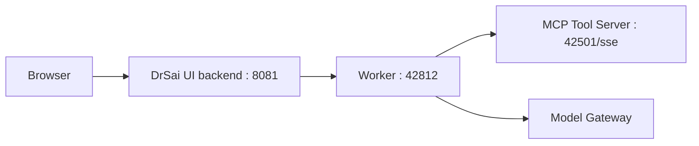

# DrSai-Rongzai

DrSai-Rongzai is a deployable worker + UI project for powder neutron diffraction refinement workflows.

This repository now supports local login/registration.

## 1. Architecture



Main runtime entrypoints:
- Worker entry: run_agent.py
- UI entry: run_ui.py
- Tool startup script: start_tools.sh
- Frontend source: webui/frontend

## Open Source Notice (GSAS-II)

This repository includes GSAS-II open-source source code under `tools/GSAS-II-master` for diffraction workflow integration.
The GSAS-II license text bundled in this repository is available at `tools/GSAS-II-master/LICENSE`.

GSAS-II is a third-party project. The copyright and license of GSAS-II belong to its original authors and maintainers.

When you redistribute this repository, please:
- keep the original GSAS-II license and copyright notices;
- comply with all license terms of GSAS-II;
- clearly indicate that GSAS-II is a third-party dependency included for integration convenience.

## 2. Prerequisites

- Linux server (recommended)
- Python 3.10+ (3.11 recommended)
- Conda (Miniconda or Anaconda)
- Node.js 18+ and Yarn 1.x
- Network access to your model gateway and MCP service

## 3. Quick Start (Local Server)

### 3.1 Clone and create environment

```bash
git clone <your-repo-url> DrSai-Rongzai
cd DrSai-Rongzai

conda create -n drsai-rongzai
conda activate drsai-rongzai
pip install -r requirements.txt

conda create -n gsas2_py311 python=3.11 -y
conda activate gsas2_py311
cd DrSai-Rongzai/tools/GSAS-II-master
pip install -r requirements.txt
```

### 3.2 Prepare environment variables

```bash
cp .env.example .env
```

At minimum, fill these fields in `.env`:
- HEPAI_API_KEY

How to get the HEPAI_API_KEY
login the platform https://aiapi/ihep.ac.cn to apply the api-key
You must apply a IHEP SSO account to login in the platform. When you apply the account, you can set the wanghao96@ihep.ac.cn as contact email.

Optional but recommended:
- RONGZAI_MCP_SSE_URL
- RONGZAI_WORKER_PORT (default 42812)
- RONGZAI_UI_PORT (default 8081)
- RONGZAI_WORKER_NAME
- RONGZAI_AGENT_INSTANCE_NAME
- RONGZAI_WORKER_AUTHOR
- RONGZAI_PERMISSION


## 4. Frontend Build and Static Sync

The UI static assets are built from Gatsby first, then synchronized into installed `drsai_ui` static directory.

```bash
cd webui/frontend
yarn install
yarn build:sync
cd ../..
```

Notes:
- If you modify `.env.development` or `.env.production` under `webui/frontend`, run `yarn build` again.
- `yarn build` only builds `public/`.
- `yarn sync:ui` copies `public/` to `drsai_ui/ui_backend/backend/web/ui`.
- If auto-detection fails, set `DRSAI_UI_STATIC_DIR` manually.
- The repository does not require `webui/backend` anymore and it can be removed safely.

## 5. Start Services

Recommended startup order:

1) Start tool services (or your own MCP server)
```bash
bash start_tools.sh
```

2) Start worker
```bash
conda activate drsai-rongzai
python run_agent.py
```

3) Start UI backend
```bash
conda activate drsai-rongzai
python run_ui.py
```

Then open:
- http://127.0.0.1:8081

## 6. Verify Deployment

Checklist:
- UI login page opens normally
- Local login/register works
- Enter chat page after login
- Sending first message does not report "Invalid start message format"
- Worker logs show tool list loaded from MCP

Quick port checks:

```bash
ss -lntp | rg '8081|42812|42501'
```

## 7. Configuration Reference

Key env vars supported by runtime:

- HEPAI_API_KEY: model gateway key
- WORKER_SPACE: data workspace root
- RONGZAI_WORKER_PORT: worker bind port
- RONGZAI_UI_PORT: UI bind port
- RONGZAI_MCP_SSE_URL: MCP SSE endpoint
- RONGZAI_WORKER_NAME: worker registration name
- RONGZAI_AGENT_INSTANCE_NAME: internal agent instance name (must be valid Python identifier)
- RONGZAI_HEPAI_BASE_URL: generic model base url
- RONGZAI_HEPAI_ANTHROPIC_BASE_URL: anthropic-compatible base url
- RONGZAI_LOGO_PATH: logo file path
- RONGZAI_WORKER_AUTHOR: worker author
- RONGZAI_WORKER_DESCRIPTION: worker description
- RONGZAI_WORKER_EXAMPLE: default example prompt
- RONGZAI_PERMISSION: worker permission string

## 8. Production Suggestions

- Run `run_agent.py` and `run_ui.py` under systemd/supervisor
- Redirect logs to rotating files
- Keep `.env` out of git
- Backup `tmp/` database files periodically if they store required history
- Pin dependency versions for reproducible releases

## 9. Security Notes

- Never commit real API keys
- Do not commit private agent endpoint lists or API keys (keep local-only configs out of git)
- Prefer `.env` for secrets instead of hardcoding in python or shell scripts
